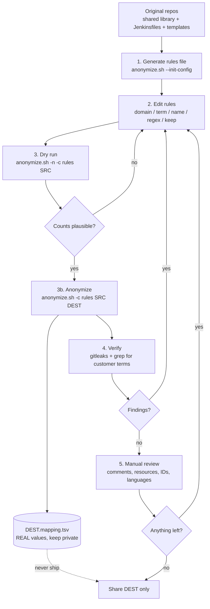

# Anonymizing Jenkins shared libraries and pipelines

Copy a Jenkins / CloudBees CI shared library (`vars/`, `src/`, `resources/`), Jenkinsfiles and
pipeline template catalogs (`template.yaml`) into a sanitized tree. Customer identifiers are
replaced with consistent placeholders, so the code stays readable and can be reviewed or shared.

`anonymize.sh` is POSIX `sh` and needs only `find`, `grep`, `sed`, `awk` and `sort`.
The source is only ever read. Output goes to a new directory.

> **Not a guarantee.** The built-in secret detection is a heuristic safety net. Always run a
> scanner on the output and review it manually (steps 4 and 5).

## Workflow



## Prerequisites

- `gitleaks` (for verification).
- Work on a fresh export of the source. `.git`, `.svn` and `.hg` are never copied, so **commit
  history is not anonymized**. Share the output directory, never the original repository.
- Symlinks are skipped. Filenames containing a single quote, tab or newline are skipped and
  reported.

## Questions to answer before you start

Collect these from the customer or the source repo. They drive the rules file.

| Question | Feeds rule |
|---|---|
| Which internal domains are used (Git, Artifactory, Nexus, Jenkins, SSO)? | `domain` |
| What are the company, product and project names, including abbreviations and other-language variants? | `term` |
| Do folder or file names contain these words (for example `vars/acmeDeploy.groovy`)? | `term` (also applied to paths) |
| Which people appear (authors in headers, `@author`, owners in comments)? | `name` |
| Are there employee IDs, ticket prefixes, cost centers or similar patterns? | `regex` / `regexi` |
| Which literal values must stay (for example `git@github.com`)? | `keep` |
| Are there cloud account IDs, cluster names, registries, bucket names? | built-in `AWSID`, `EKS`; otherwise `term` |
| Which output are you allowed to share, and with whom? | decides the review depth |

## 1. Generate a rules file

```sh
./anonymize.sh --init-config > my-project.rules
```

## 2. Edit the rules

One rule per line, fields separated by `|`. `#` starts a comment only at the start of a line.

```text
# Internal domain: FQDNs under it become host-NNN.example.com, the bare domain becomes example.com
domain|corp.acme-example.net
domain|acme-example.local

# Case-insensitive, case-preserving: acmecorp -> customer, AcmeCorp -> Customer, ACMECORP -> CUSTOMER
# Also renames matching files and directories
term|acmecorp|customer
term|acme|customer
term|zeus-platform|platform-x

# Personal names: list each spelling and order
name|Jane Doe
name|Doe Jane

# Employee IDs such as ab12345 or AB12345
regexi|EMPID|USER|ab[0-9][0-9][0-9][0-9][0-9]

# Ticket keys such as ACME-1234
regex|TICKET|TICKET|ACME-[0-9]+

# Never replace these
keep|git@github.com
```

Tips:

- Put longer terms before shorter ones that overlap (`zeus-platform` before `zeus`), and check
  the dry run.
- Short `term` values match as substrings. `acme` would also hit `pacmeter`. Prefer longer
  terms, or use `regex` (whole-word).
- Add every spelling you find: abbreviations, hyphenated and camelCase forms, translated names.
- The built-in categories can be disabled with `--skip EMAIL,EKS,IP,AWSID,SECRET`.

| Built-in category | Replaced with |
|---|---|
| `EMAIL` | `user-NNN@example.com` |
| `EKS` (EKS API endpoints) | `eks-endpoint-NNN.eks.example.com` |
| `IP` (RFC1918) | RFC 5737 documentation ranges |
| `AWSID` (12-digit numbers) | `00000000000N` |
| `SECRET` (keys, tokens, URL passwords, `--password X`, `password = "literal"`) | `REDACTED-SECRET-NNN` |

References such as `${VAR}`, `credentials('...')`, `params.X` and names ending in
`id`, `name`, `file`, `path`, `url`, `ref`, `env`, `var`, `type`, `prompt` or `dir`
(`credentialsId` style) are deliberately left alone.

## 3. Dry run, then anonymize

```sh
# Report matches per category and file, write nothing
./anonymize.sh -n -c my-project.rules jenkins-shared-libraries

# Write the sanitized copy. DEST must not exist and must not be inside SRC.
./anonymize.sh -c my-project.rules \
  jenkins-shared-libraries jenkins-shared-libraries-clean-anonymized
```

The mapping file is written next to `DEST` as `DEST.mapping.tsv`, or wherever `-m` points.
It is never allowed inside the source or destination tree.

### Example: before and after

Before (`vars/deployToEks.groovy`):

```groovy
// Maintained by Jane Doe (ab12345@corp.acme-example.net)
def call(Map cfg = [:]) {
  def registry = '123456789012.dkr.ecr.eu-west-1.amazonaws.com/acmecorp'
  def api      = 'https://ABCDEF1234567890.gr7.eu-west-1.eks.amazonaws.com'
  withCredentials([string(credentialsId: 'acme-deploy-token', variable: 'TOKEN')]) {
    sh "kubectl --server=${api} --token=${TOKEN} set image deploy/${cfg.app} app=${registry}/${cfg.app}:${cfg.tag}"
  }
  sh 'curl -u svc_build:S3cr3tPassw0rd https://nexus.corp.acme-example.net/repository/acme-releases/'
}
```

After:

```groovy
// Maintained by Person-001 (USER-001@example.com)
def call(Map cfg = [:]) {
  def registry = '000000000001.dkr.ecr.eu-west-1.amazonaws.com/customer'
  def api      = 'https://eks-endpoint-001.eks.example.com'
  withCredentials([string(credentialsId: 'acme-deploy-token', variable: 'TOKEN')]) {
    sh "kubectl --server=${api} --token=${TOKEN} set image deploy/${cfg.app} app=${registry}/${cfg.app}:${cfg.tag}"
  }
  sh 'curl -u svc_build:REDACTED-SECRET-001 https://host-001.example.com/repository/customer-releases/'
}
```

Note that `credentialsId: 'acme-deploy-token'` was **not** changed, because the built-in secret
logic skips `*Id` names. Add a `term|acme|customer` rule, or the value stays and shows up in
the manual review. The sample output is illustrative. Check the real result on your tree.

Pipeline templates are handled the same way (`template.yaml`, `Jenkinsfile`, `README.md`):

```yaml
# before
name: acme-eks-deploy
description: Deploy to the ACME Zeus cluster
# after
name: customer-eks-deploy
description: Deploy to the CUSTOMER platform-x cluster
```

## 4. Verify

```sh
# Secret scan of the sanitized output
gitleaks dir ./jenkins-shared-libraries-clean-anonymized \
  --redact \
  --report-format sarif \
  --report-path gitleaks-report.sarif \
  --verbose

# Leftover customer terms (use the same words as in your rules). Expect no output.
grep -rIinE 'acme|zeus|corp\.acme-example|jane|doe' ./jenkins-shared-libraries-clean-anonymized

# Leftover file or directory names
find ./jenkins-shared-libraries-clean-anonymized -iname '*acme*'
```

Example gitleaks finding (fictional, `--redact` hides the value):

```text
Finding:     password = "REDACTED"
Secret:      REDACTED
RuleID:      generic-api-key
File:        vars/publishArtifact.groovy
Line:        42
```

Triage:

1. Is it a real secret, or a placeholder such as `REDACTED-SECRET-001`? Placeholders are fine.
2. If real, add a `term`, `regex` or `keep` rule (or fix the pattern) and re-run step 3.
3. If a false positive, document it. Use a `.gitleaksignore` entry only for the sanitized copy.
4. Re-run until the report is clean, and keep the SARIF report as evidence of the check.

## 5. Manual review checklist

Regex and scanners miss context. Review the output for:

- [ ] Comments, Javadoc and Groovydoc (names, ticket links, internal wiki URLs)
- [ ] Non-English text (for example error messages and comments that name the customer)
- [ ] `resources/` files: shell scripts, YAML, JSON, pod templates, Dockerfiles, `.properties`
- [ ] Hardcoded IDs: Jenkins credential IDs, Slack channels, Jira project keys, Sonar project keys
- [ ] Registry, cluster, namespace, bucket and node-label names that identify the customer
- [ ] Git remotes and SSH URLs (`git@host:org/repo.git`)
- [ ] Pipeline template catalog metadata: `template.yaml` names, descriptions, labels, `README.md`
- [ ] Test fixtures and sample data containing real values
- [ ] Binary or archive files (jars, zips, images). The script treats only text files, so remove or
      inspect these separately.
- [ ] File and directory names (`find ... -iname`)
- [ ] The dry-run counts: zero hits for a category you expected to match is suspicious

## 6. Mapping file (de-anonymization)

`DEST.mapping.tsv` maps original to placeholder and contains the **real values**. It is created
with mode `0600`.

- Never ship it, commit it, or put it in the sanitized tree.
- Store it in an access-controlled location, and delete it when the engagement ends.
- Use it to translate findings back, for example `Person-001` or `host-004.example.com`:

```sh
awk -F'\t' '$2 == "host-004.example.com"' jenkins-shared-libraries-clean-anonymized.mapping.tsv
```

(The column order is `original<TAB>placeholder` by assumption. Check the header of your mapping
file first.)

## Known limitations

- Heuristic secret detection. Obfuscated or unusually formatted secrets can be missed.
- Version control history is not copied, so the output has no history.
- Text files get a trailing newline.
- Placeholders are consistent within one run. A second run produces its own numbering unless you
  reuse the same rules and source, so do not mix outputs of different runs.
- Validate the sanitized library in a test Jenkins before relying on it. Replaced names can change
  behavior (for example folder paths and library names used in `@Library('...')`).
